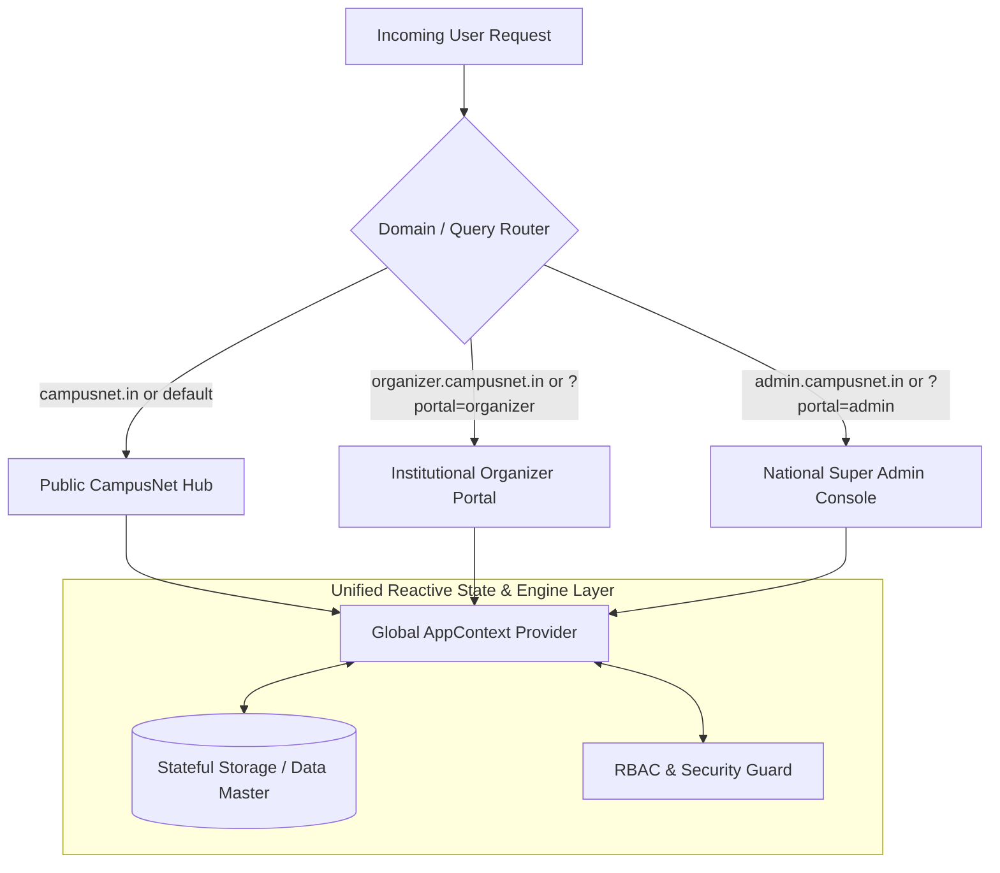

# 🎓 CampusNet+ Master Technical Documentation & System Specification
**India's Premier National Academic, Innovation & Research Network**  
*Document Version: 1.0.0 (Production Release) | System Architect: Senior Staff Web Developer*

---

## 📑 Table of Contents (10-Page Structural Index)

1. [PAGE 1: Executive Summary & Project Vision](#page-1-executive-summary--project-vision)
2. [PAGE 2: System Architecture & Multi-Portal Routing Engine](#page-2-system-architecture--multi-portal-routing-engine)
3. [PAGE 3: Technology Stack, Build Pipeline & Codebase Structure](#page-3-technology-stack-build-pipeline--codebase-structure)
4. [PAGE 4: Domain Models & Core TypeScript Entities](#page-4-domain-models--core-typescript-entities)
5. [PAGE 5: Public Platform Modules & Discovery Engine](#page-5-public-platform-modules--discovery-engine)
6. [PAGE 6: Team Collaboration Workspace & Real-Time Interaction](#page-6-team-collaboration-workspace--real-time-interaction)
7. [PAGE 7: Institutional Event Organizer Portal](#page-7-institutional-event-organizer-portal)
8. [PAGE 8: National Super Admin & Governance Console](#page-8-national-super-admin--governance-console)
9. [PAGE 9: Security Engineering, Validation & Anti-Fraud Mechanisms](#page-9-security-engineering-validation--anti-fraud-mechanisms)
10. [PAGE 10: Deployment Guide, Operations & Future Technical Roadmap](#page-10-deployment-guide-operations--future-technical-roadmap)

---

<!-- ========================================================================== -->
<!-- PAGE 1 -->
<!-- ========================================================================== -->
# PAGE 1: Executive Summary & Project Vision

### 1.1 Project Identity & High-Level Scope
**CampusNet+** is a national-scale digital infrastructure designed to bridge higher education institutions across all 28 States and 8 Union Territories of India. It integrates higher education students, accredited faculty mentors, PhD research scholars, corporate partners, and university event chairs into a unified, high-integrity innovation network.

| Attribute | Specification |
| :--- | :--- |
| **System Name** | CampusNet+ (National Student Innovation & Research Network) |
| **Target Audience** | 10,000+ Students, 850+ Faculty Mentors, 520+ PhD Scholars, 450+ Colleges |
| **Primary Domain** | Higher Education, Hackathon Management, Academic Research, Verified Credentials |
| **Regulatory Alignment**| AICTE Innovation Cell, Smart India Hackathon (SIH), AISHE Directory, NAAC/NIRF |
| **Access Model** | Multi-tenant, 3-Tier Enterprise Portal with Role-Based Access Control (RBAC) |

### 1.2 The Problem Space
In the contemporary Indian academic landscape, higher education innovation remains severely fragmented:
1. **Institutional Silos**: Students from tier-2 and tier-3 colleges lack access to elite research mentors and multi-disciplinary collaborators at premier institutes (IITs, NITs, IISc).
2. **Hackathon Proxy & Fraud**: Collegiate technical fests struggle with attendance fraud, proxy check-ins, untracked evaluations, and unverified student participation.
3. **Unverified Credentials**: Paper-based certificates of participation and project mentorship are easily forged and lack an immutable, machine-readable verification pipeline.
4. **Research Isolation**: Academic papers, datasets, and intellectual property developed during undergraduate and postgraduate courses frequently gather dust without discovery or cross-institutional adoption.

### 1.3 The CampusNet+ Solution
CampusNet+ resolves these systemic challenges through a coordinated digital platform:
- **Centralized Project & Team Incubator**: Multi-department team formation (Hardware, Software, Design, Research) paired with automated mentor recommendation algorithms.
- **Geofenced, Anti-Proxy Attendance Terminal**: Mobile-first QR code scanning coupled with GPS coordinate boundary validation (target latitude/longitude within configurable radius meters).
- **End-to-End Event Lifecycle Engine**: From 30+ field event creation wizards and multi-criteria weighted judging rubrics to automated digital winner minting.
- **Tamper-Proof National Credential Registry**: Cryptographically serial-numbered certificates embedded with dynamic QR codes, allowing instant verification or Super Admin fraud revocation.
- **Unified Academic Transcript**: One-page exportable and printable AI Innovation Transcript showcasing student competencies, verified hackathon finishes, and faculty recommendations.

### 1.4 Pan-India Footprint & Baseline Metrics
```
[Pan-India Scope]
  ├── 28 States & 8 Union Territories Master Geolocation Index
  ├── 450+ Accredited Institutions (IITs, NITs, IIITs, Central & State Universities, Autonomous Colleges)
  ├── 10,000+ Active Student Innovators
  ├── 850+ Verified Faculty Mentors (with Vidwan INFLIBNET Integration)
  ├── 520+ PhD Research Scholars
  └── 1,200+ National Hackathon, Ideathon, and Symposium Projects
```

---

<!-- ========================================================================== -->
<!-- PAGE 2 -->
<!-- ========================================================================== -->
# PAGE 2: System Architecture & Multi-Portal Routing Engine

### 2.1 Multi-Tier Enterprise Portal Architecture
CampusNet+ enforces a strict architectural boundary dividing public community operations from privileged event organization and national oversight. The platform utilizes a single, highly optimized React client bundle dynamically resolving one of three runtime portals based on host subdomains or development route parameters.



### 2.2 Portal Routing Matrix & Access Control
The routing engine (`src/components/portal/PortalRouter.tsx`) inspects both `window.location.hostname` and query parameters (`?portal=...`) to ensure full compatibility across local development environments, cloud preview environments, and production multi-domain infrastructures.

| Portal | Target Environment | Hostname Mapping | Fallback Parameter | Primary Functionality |
| :--- | :--- | :--- | :--- | :--- |
| **🌐 Public Hub** | Public Internet | `campusnet.in`, `localhost:3000` | (Default root) | Discovery, projects, mentoring, research, workspace, public verification. |
| **🏢 Organizer Portal** | Institutional Event Chairs | `organizer.campusnet.in` | `?portal=organizer` or `/organizer` | Event wizard, participant rosters, QR scanners, judging consoles, certificates. |
| **🛡️ Super Admin** | National Oversight Board | `admin.campusnet.in` | `?portal=admin` or `/admin` | Event moderation queue, college accreditation, user bans, fraud revocation. |

### 2.3 Portal Router Implementation Details
The routing logic evaluates priority order:
1. **Subdomain Detection**: Evaluates prefixes `organizer.*` and `admin.*`.
2. **Explicit Path Prefix**: Inspects `/organizer`, `/portal/organizer`, `/admin`, `/portal/admin`.
3. **Query Parameter Fallback**: Inspects URL search query `portal=organizer` or `portal=admin`.
4. **Default Public Fallback**: Resolves to `public` when no privileged prefix or query is encountered.

### 2.4 State Management & Data Flow
Global state is managed via `AppContext.tsx` (`src/context/AppContext.tsx`), which provides a single source of truth across all 19 functional domains. State updates trigger immediate reactive re-renders across all active views without cross-portal state collisions.

---

<!-- ========================================================================== -->
<!-- PAGE 3 -->
<!-- ========================================================================== -->
# PAGE 3: Technology Stack, Build Pipeline & Codebase Structure

### 3.1 Technology Stack Specifications

| Technology Layer | Tool / Library | Version | Technical Justification |
| :--- | :--- | :--- | :--- |
| **UI Framework** | React | `v19.0.0` | Concurrent rendering, declarative component tree, component modularity. |
| **Language** | TypeScript | `v5.7.3` | Type-safety, strict domain models, static compile-time error detection. |
| **Build & Dev Tool**| Vite | `v6.2.0` | Sub-second Hot Module Replacement (HMR), tree-shaking, Rollup bundling. |
| **Styling Engine** | Tailwind CSS | `v3.4.17` | Utility-first styling, consistent spacing, custom theme colors, responsive grid. |
| **Routing** | React Router DOM | `v7.18.2` | Declarative client-side routing, route param extraction, SPA navigation. |
| **Iconography** | Lucide React | `v1.16.0` | Lightweight, tree-shakeable SVG icons for academic and administrative UI. |
| **QR Code Engine** | qrcode | `v1.5.4` | HTML5 Canvas rendering of tamper-proof verification strings and URLs. |
| **Visual Effects** | canvas-confetti | `v1.9.4` | Hardware-accelerated celebration triggers upon winning awards and submissions. |
| **Production Server**| Node.js Native HTTP | `v18+ / v20+` | Zero-dependency SPA fallback server with strict MIME types & asset caching. |

### 3.2 Production Server Architecture (`server.js`)
CampusNet+ includes an optimized, production-grade Node.js HTTP server configured for high concurrency and static asset delivery:
- **MIME Type Mapping**: Serves `.html`, `.js`, `.css`, `.json`, `.png`, `.jpg`, `.svg`, `.ico`, and web fonts (`.woff`, `.woff2`, `.ttf`).
- **Cache-Control Policies**:
  - HTML documents: `no-cache` (ensures users always fetch latest frontend builds).
  - Versioned assets (JS/CSS/images): `public, max-age=31536000, immutable` (maximum browser cache utilization).
- **Single Page Application (SPA) Fallback**: Any non-file path request (e.g., `/projects/proj-101`, `/verify/CN-2026-WIN`) automatically streams `dist/index.html` with HTTP 200.

### 3.3 Codebase File & Directory Hierarchy
```
c:\projects\CampusNet\
├── index.html                  # HTML5 Entry point & Google Fonts (Inter, Plus Jakarta Sans)
├── package.json                # Dependencies, scripts, and build configuration
├── server.js                   # Node.js production HTTP SPA server
├── tailwind.config.js          # Custom color palette (campus-red, campus-blue, warm-white)
├── tsconfig.json               # TypeScript compiler options (strict, ESNext)
├── vite.config.ts              # Vite plugins and dev server host configurations
├── railway.json / vercel.json  # Cloud platform deployment manifests
└── src/
    ├── App.tsx                 # Root application wrapper, router, and modal overlays
    ├── main.tsx                # React DOM root bootstrapping
    ├── context/
    │   └── AppContext.tsx      # Global React Context provider (state, actions, mutators)
    ├── data/
    │   └── mockData.ts         # Comprehensive seed datasets (colleges, events, users, certs)
    ├── types/
    │   └── index.ts            # Master TypeScript definitions and domain interfaces
    ├── utils/
    │   ├── locationData.ts     # 28 States + 8 UTs master geolocation index & district mapper
    │   └── validation.ts       # Allowlist domain validators, file upload sanitizer
    └── components/
        ├── admin/              # Super Admin Console (Moderation, Users, Colleges, Fraud)
        ├── ai/                 # Campus AI Assistant (Pitch generator, Mentor matching)
        ├── auth/               # Multi-role authentication & registration dialogs
        ├── certificates/       # Printable digital certificate generator & verification engine
        ├── common/             # Navbar, Footer, MobileNav, Toast notifications, Fallbacks
        ├── community/          # "Ask Campus" Q&A and "Campus Stories" video showcases
        ├── dashboard/          # Student, Mentor, and Researcher personal dashboards
        ├── discovery/          # Universal federated search & ecosystem directory
        ├── events/             # Public events catalogue & registration modals
        ├── landing/            # Landing page sections (Hero, Tickers, Pillars, Challenges)
        ├── mentors/            # Mentor directory, filtering, and booking workflows
        ├── messaging/          # 1-on-1 direct messaging and connection requests
        ├── network/            # User public profile modal and portfolio view
        ├── organizer/          # Institutional Organizer portal (Wizard, QR, Judging, Roster)
        ├── portal/             # PortalRouter multi-domain switching logic
        ├── projects/           # Projects ecosystem, filters, and team formation links
        ├── research/           # Research papers, conference listings, Vidwan scholar links
        └── workspace/          # Private Team Studio (Kanban, Chat, Video Call, Milestones)
```

---

<!-- ========================================================================== -->
<!-- PAGE 4 -->
<!-- ========================================================================== -->
# PAGE 4: Domain Models & Core TypeScript Entities

CampusNet+ is built on an enterprise-grade type system (`src/types/index.ts`). Below are the primary entities governing the system:

### 4.1 User & Identity Hierarchy
```typescript
export type RoleType = 'student' | 'mentor' | 'researcher' | 'organizer' | 'superadmin';

export interface User {
  id: string;
  name: string;
  email: string;
  mobile: string;
  studentId?: string;
  institution: string;
  university: string;
  department: string;
  course: string;
  year: string;
  state?: string;
  city?: string;
  verifiedStudent: boolean;
  innovationScore: number;
  skills: string[];
  badges: string[];
  bio: string;
  interests: string[];
  socialLinks?: UserSocialLinks;
  role: RoleType;
  status?: 'active' | 'suspended' | 'pending_verification';
}
```

### 4.2 Project & Team Workspace Models
```typescript
export interface ProjectMilestone {
  id: string;
  title: string;
  description: string;
  status: 'approved' | 'in_progress' | 'pending' | 'rejected';
  dueDate: string;
  approvedByMentor?: boolean;
  mentorFeedback?: string;
}

export interface Project {
  id: string;
  title: string;
  problemStatement: string;
  proposedSolution: string;
  domain: string;
  technologies: string[];
  requiredSkills: string[];
  teamId?: string;
  teamName?: string;
  institution: string;
  mentor?: string;
  mentorId?: string;
  status: 'Idea' | 'Planning' | 'Development' | 'Prototype' | 'Testing' | 'Completed' | 'Published';
  progressPercent: number;
  githubUrl?: string;
  milestones: ProjectMilestone[];
  tasks: ProjectTask[];
}
```

### 4.3 Event Management & Geofenced Attendance Models
```typescript
export type EventStatus = 
  | 'draft' | 'submitted' | 'pending_document_verification'
  | 'pending_admin_approval' | 'changes_requested' | 'approved'
  | 'rejected' | 'published' | 'live' | 'completed' | 'archived';

export interface EventItem {
  id: string;
  code?: string;
  title: string;
  organizer: string;
  organizerId?: string;
  eventType: 'Hackathon' | 'Ideathon' | 'Government Challenge' | 'Research Symposium';
  state: string;
  city: string;
  mode: 'Offline' | 'Online' | 'Hybrid';
  attendanceWindow: {
    start: string;
    end: string;
    targetLat: number;
    targetLng: number;
    allowedRadiusMeters: number;
  };
  prizes: EventPrize[];
  rules: string[];
  tracks: string[];
  status: EventStatus;
}
```

### 4.4 Cryptographic Digital Credentials & Audit Logs
```typescript
export interface Certificate {
  id: string;
  certificateNumber: string; // e.g. CN-KEC-AI26-PART-000101
  recipientName: string;
  recipientRole: 'Participant' | 'Winner' | 'Runner-Up' | 'Mentor' | 'Judge';
  eventTitle: string;
  eventOrganizer: string;
  issueDate: string;
  qrCodeData: string;
  verified: boolean;
  institution: string;
  status: 'valid' | 'revoked';
  revocationReason?: string;
}

export interface AuditLogEntry {
  id: string;
  actorId: string;
  actorName: string;
  actorRole: string;
  action: string;
  targetType: 'event' | 'certificate' | 'institution' | 'user' | 'security';
  targetId: string;
  targetName: string;
  timestamp: string;
  details: string;
}
```

---

<!-- ========================================================================== -->
<!-- PAGE 5 -->
<!-- ========================================================================== -->
# PAGE 5: Public Platform Modules & Discovery Engine

### 5.1 Universal Federated Search Engine
The platform includes an intelligent federated search bar (`src/components/landing/FederatedSearchDropdown.tsx`) operating across multiple entity sets simultaneously:
- Queries execute in real-time across Students, Projects, Events, Mentors, and Research Papers.
- Keyboard navigation (`ArrowUp`, `ArrowDown`, `Enter`, `Escape`) with categorized match grouping.
- Deep links route directly to corresponding entity modals or ecosystem detail views.

### 5.2 Projects Ecosystem & Open Role Incubator
Located at `/projects`, the Projects Ecosystem features multi-faceted filtering:
1. **Domain Filtering**: Artificial Intelligence, Agritech, Clean Energy, MedTech, IoT, CyberSecurity.
2. **State & City Selectors**: Powered by the 28 States and 8 Union Territories database.
3. **Open Role Matching**: Filter projects actively seeking members (e.g., "Looking for Edge AI Developer" or "Looking for Firmware Engineer").
4. **1-Click Role Application**: Students apply directly with their portfolio credentials.

### 5.3 Faculty Mentorship Network & Multi-Dimensional Match Algorithm
The Mentor Directory (`/mentors`) connects students with verified university faculty and senior industry specialists. The platform computes a real-time **Match Score (0–100%)** using a four-factor heuristic:
$$\text{MatchScore} = w_1 \cdot S_{\text{domain}} + w_2 \cdot S_{\text{tech}} + w_3 \cdot S_{\text{research}} + w_4 \cdot S_{\text{availability}}$$
- $S_{\text{domain}}$: Overlap between mentor specialization and student project category.
- $S_{\text{tech}}$: Alignment between student technologies and mentor skills.
- $S_{\text{research}}$: Mentor research publications in the project problem statement.
- $S_{\text{availability}}$: Mentor active team load vs. maximum allowable mentoring slots.
- **Vidwan Integration**: Mentors can link their official Vidwan profile for academic validation.

### 5.4 Research Hub & Scholarly Collaboration
The Research Hub (`/research`) facilitates academic rigor:
- **Research Publication Index**: Search peer-reviewed publications with direct DOI links, citation counts, and associated open dataset repositories.
- **National Conference Calendar**: Track upcoming IEEE, Springer, and ACM conferences held across Indian institutes.
- **Research Collaboration Requests**: PhD scholars advertise available research lab positions and invite student research assistants.

### 5.5 Student Innovation Portfolio & 1-Page AI Innovation Transcript
Accessible via `/portfolio`, the Student Portfolio aggregates an individual’s academic innovation identity:
- **Dynamic Innovation Score**: Computed from verified hackathon finishes, approved project milestones, open-source repositories, and peer answers.
- **1-Page Printable Transcript**: Modal (`InnovationTranscriptModal.tsx`) formatted to standard A4 specifications, including student bonafide badges, project summaries, mentor endorsements, and a QR code resolving to the student's live digital portfolio.

---

<!-- ========================================================================== -->
<!-- PAGE 6 -->
<!-- ========================================================================== -->
# PAGE 6: Team Collaboration Workspace & Real-Time Interaction

### 6.1 Private Team Studio (`/workspace/:teamId`)
When students form an approved project team, CampusNet+ automatically provisions a dedicated collaborative workspace. The studio is restricted to team members and their assigned faculty mentor.

```
[Team Workspace Studio Architecture]
  ├── 1. Overview Ribbon & Milestone Velocity Bar (0 - 100%)
  ├── 2. Kanban Task Board (Todo → In Progress → Done)
  ├── 3. Integrated Team Chat (Markdown, Code Snippets, File Attachments)
  ├── 4. Mentor Guidance Stream & Formal Milestone Approvals
  └── 5. WebRTC Video Call Simulator (Camera, Mic, Screen Share)
```

### 6.2 Stateful Kanban Task Board
The Kanban board (`src/components/workspace/KanbanBoard.tsx`) enables rapid task execution:
- Three active swimlanes: **To Do**, **In Progress**, and **Completed**.
- Task cards display assignee avatars, priority badges (Low, Medium, High), and due dates.
- Tasks dynamically update the overall project velocity percentage upon completion.

### 6.3 Real-Time Team Chat Stream
Located within the workspace (`src/components/workspace/TeamChat.tsx`):
- Persistent chronological discussion thread supporting Markdown formatting.
- File attachment sharing for schematics, API payloads, and presentation slide decks.
- Role-badged messages distinguishing Student leads from Faculty Mentors.

### 6.4 WebRTC Video Call Simulator
The workspace features a high-fidelity video meeting console (`src/components/workspace/VideoCallModal.tsx`):
- Simulated peer connection states with audio/video stream toggles.
- Screen sharing simulation for technical code reviews and slide decks.
- Real-time network telemetry indicator (Excellent / Good / Reconnecting).
- Participant roster with active speaker indicators and audio levels.

### 6.5 Mentor Guidance & Milestone Sign-Off Lifecycle
The mentor interface (`src/components/workspace/MentorGuidanceTab.tsx`) establishes a formal audit trail:
- Mentors review completed milestones and either issue **Milestone Approval** or request revisions with written feedback.
- Mentors assign targeted technical reading and reference resources.
- Upon project completion, mentors trigger the **Mentorship Certificate Generator**, minting a verified credential certifying their direct guidance of the student team.

---

<!-- ========================================================================== -->
<!-- PAGE 7 -->
<!-- ========================================================================== -->
# PAGE 7: Institutional Event Organizer Portal

Accessible via `?portal=organizer` or `organizer.campusnet.in`, the Organizer Portal provides colleges and event chairs with a complete administrative cockpit.

### 7.1 30+ Field Event Creation Wizard
The Event Wizard (`src/components/organizer/EventCreationWizard.tsx`) enforces comprehensive event specifications:
1. **Step 1: Event Identity & Coordinator**: Event title, system code, event type, category, theme, banner image, coordinator name, official designation, institutional email, and mobile phone.
2. **Step 2: Geolocation & Geofencing Parameters**: State, district (auto-filtered based on selected state), city, venue name, postal address, PIN code, event mode (Offline/Online/Hybrid), venue GPS coordinates (Target Latitude and Longitude), and allowed check-in radius (e.g., 500 meters).
3. **Step 3: Dates, Eligibility & Tracks**: Start/end dates, registration windows, eligible degree courses and departments, team size constraints (minimum/maximum members), prize pool breakdown, event rules, and schedule itinerary.
4. **Step 4: Formal Verification Uploads**: Mandatory attachment of formal sanction letters or college approval documents (`.pdf`, `.png`, `.jpg` up to 10 MB) verifying institutional sponsorship.

### 7.2 Event Lifecycle State Machine
Events progress through a strictly monitored lifecycle:
$$\text{Draft} \longrightarrow \text{Submitted} \longrightarrow \text{Super Admin Review} \longrightarrow \begin{cases} \text{Approved} \longrightarrow \text{Published} \longrightarrow \text{Live} \longrightarrow \text{Completed} \\ \text{Changes Requested} \longrightarrow \text{Resubmitted} \\ \text{Rejected} \end{cases}$$

### 7.3 Dual-Verification Attendance Terminal
The Attendance Terminal (`src/components/organizer/AttendanceQRScannerView.tsx`) eliminates proxy attendance during physical hackathons:
- **Optical Camera Simulator**: Scans participant QR codes in real-time.
- **Anti-Duplicate Check-In**: The system rejects re-scans, displaying the exact timestamp and officer who validated the first check-in.
- **Manual Roll Number Override**: Fallback input allowing coordinators to verify students using their university registration number or email address with audit trail logging.

### 7.4 Multi-Criteria Weighted Judging Console
The judging system (`src/components/organizer/JudgeScoringPortal.tsx`) allows external jury panels to score team projects:
- **Secure Access Keys**: Judges authenticate with unique tokens (e.g., `JUDGE-KEC-RAO-99`).
- **Weighted Criteria Rubrics**: Evaluates projects across Innovation (30%), Technical Complexity (30%), Practical Viability (25%), and Presentation (15%).
- **Automated Weighted Score Computation**:
$$\text{FinalScore} = \sum_{i=1}^{n} \left( \frac{\text{CriterionScore}_i}{\text{MaxScore}_i} \times \text{Weightage}_i \right)$$
- **Live Leaderboard**: Real-time ranking automatically populates the Winner Selection console.

### 7.5 Certificate Management Center
The Certificate Center (`src/components/organizer/CertificateManagementCenter.tsx`) enables:
- **Template Customization**: Accent color picking, custom wording, and multiple authorized signatories.
- **1-Click Bulk Minting**: Generates unique, tamper-proof certificate numbers (e.g., `CN-KEC-AI26-PART-000101`) for all verified participants or winners.
- **Automatic QR Embedding**: Dynamically generates embedded QR codes pointing to `/verify/:certId`.

---

<!-- ========================================================================== -->
<!-- PAGE 8 -->
<!-- ========================================================================== -->
# PAGE 8: National Super Admin & Governance Console

Accessible via `?portal=admin` or `admin.campusnet.in`, the Super Admin Console empowers national accreditation authorities to govern the ecosystem.

### 8.1 National Event Moderation Queue
Located at `src/components/admin/SuperAdminEventModeration.tsx`:
- Inspects all college-submitted event proposals across India.
- Evaluates attached institution bonafide proof documents.
- Super Admins can **Approve & Publish**, **Request Modifications** (with inline administrative notes), or **Reject with Written Cause**.

### 8.2 Institutional Accreditation & AISHE Verification
The Institution Manager (`src/components/admin/SuperAdminInstitutionManager.tsx`):
- Governs 450+ higher education institutions across all states.
- Verifies official AISHE (All India Survey on Higher Education) codes and domain email patterns (`.ac.in`, `.edu.in`).
- Grants verified green badges or suspends institutions failing quality audits.
- Supports CSV batch importing of new universities and polytechnics.

### 8.3 National User Moderation & Verification Badging
The User Moderator (`src/components/admin/SuperAdminUserModerator.tsx`):
- Audits student IDs, faculty designations, and researcher credentials.
- Issues bonafide student verification badges upon document inspection.
- Enforces community guidelines with 1-click account suspensions and reactivations.

### 8.4 Certificate Fraud Auditor & Instant Revocation Engine
The Fraud Auditor (`src/components/admin/SuperAdminCertificateAuditor.tsx`):
- Pan-India search directory covering all issued event and mentorship certificates.
- Enables instant cryptographic revocation of fraudulent or disputed credentials.
- When revoked, the public verification portal immediately marks the certificate with a bold red warning displaying the revocation timestamp, auditor identity, and justification.

### 8.5 National Innovation Intelligence & System Audit Trail
- **State-Wise Analytics**: Real-time breakdown of innovation density, hackathon participation, and project outcomes per Indian state/UT.
- **Immutable Security Logs**: Comprehensive log (`src/components/admin/SuperAdminAuditLogsView.tsx`) tracking all administrative operations (Actor ID, Target Entity, IP Address, Timestamp, Action Details).

---

<!-- ========================================================================== -->
<!-- PAGE 9 -->
<!-- ========================================================================== -->
# PAGE 9: Security Engineering, Validation & Anti-Fraud Mechanisms

### 9.1 Geofencing Mathematics & Anti-Proxy Check-In
To ensure participants are physically present at the hackathon venue before attendance check-in is authorized, the system utilizes the **Haversine Distance Formula** to calculate the great-circle distance between the user's GPS coordinates $(\phi_1, \lambda_1)$ and the venue anchor $(\phi_2, \lambda_2)$:

$$a = \sin^2\left(\frac{\Delta\phi}{2}\right) + \cos(\phi_1)\cos(\phi_2)\sin^2\left(\frac{\Delta\lambda}{2}\right)$$
$$c = 2 \cdot \text{atan2}\left(\sqrt{a}, \sqrt{1-a}\right)$$
$$d = R \cdot c$$
*(where $R = 6,371,000\text{ meters}$, the mean radius of the Earth)*

If the computed distance $d > \text{allowedRadiusMeters}$, the check-in is rejected, preventing remote attendance fraud.

### 9.2 Cryptographic Verification Engine
Every certificate issued through CampusNet+ receives an immutable, collision-resistant identifier:
$$\text{CertID} = \text{CN}-\text{INSTITUTION}-\text{EVENT\_CODE}-\text{ROLE\_SLUG}-\text{SERIAL\_HASH}$$
*(Example: `CN-KEC-AI26-PART-000101` or `CN-2026-MNT-8F2A-3914`)*

The embedded QR code payload encodes the absolute public authentication URL:
`https://campusnet.in/verify/CN-KEC-AI26-PART-000101`

### 9.3 Strict Input Sanitization & Domain Allowlists (`validation.ts`)
To protect against Cross-Site Scripting (XSS), URL injection, and phishing:
- **Social URL Allowlists**: Profile links are strictly validated against authorized domains:
  - LinkedIn: `linkedin.com`, `in.linkedin.com`
  - GitHub: `github.com`
  - Twitter/X: `twitter.com`, `x.com`
  - LeetCode: `leetcode.com`, `leetcode.in`
  - Vidwan: `vidwan.inflibnet.ac.in`
- **File Upload Protection**:
  - Max file size enforced: $10\text{ MB}$.
  - Strict MIME allowlist: `application/pdf`, `image/png`, `image/jpeg`, `image/webp`.
  - Executable blacklist: `.exe`, `.bat`, `.sh`, `.cmd`, `.js`, `.vbs`, `.php`, `.py`, `.apk`, `.bin`.
  - Filename sanitization to strip directory traversal sequences (`../`, `..\`).
- **Input Sanitization**: All freeform string inputs are stripped of `<script>` tags and `javascript:` pseudo-protocols.

### 9.4 Role-Based Access Control (RBAC)
CampusNet+ enforces five granular privilege levels:
1. `student`: Access to personal projects, team studios, registrations, portfolio.
2. `mentor`: Access to assigned team studios, milestone approvals, mentorship certification.
3. `researcher`: Access to research publications, datasets, collaboration proposals.
4. `organizer`: Access to event creation, participant check-in terminal, judging rosters.
5. `superadmin`: Unrestricted national governance, moderation queue, accreditation, fraud audits.

---

<!-- ========================================================================== -->
<!-- PAGE 10 -->
<!-- ========================================================================== -->
# PAGE 10: Deployment Guide, Operations & Future Technical Roadmap

### 10.1 Local Development & Environment Setup

#### Prerequisites
- Node.js (v18.0.0 or later, v20 LTS recommended)
- npm (v9.0.0 or later) or yarn

#### Step-by-Step Installation
```bash
# 1. Clone the repository
git clone https://github.com/moglieswarachary-droid/campusnet.git
cd campusnet

# 2. Install dependencies
npm install

# 3. Launch Vite development server with local network binding
npm run dev -- --host
```

#### Local Access Endpoints
- **Public Platform**: `http://localhost:3000/`
- **Organizer Portal**: `http://localhost:3000/?portal=organizer`
- **Super Admin Console**: `http://localhost:3000/?portal=admin`

### 10.2 Production Build & Deployment

#### Compiling Production Bundle
```bash
# Compiles TypeScript declarations and outputs optimized assets to dist/
npm run build

# Preview build locally
npm run preview
```

#### Production Server Execution
```bash
# Starts the native HTTP SPA production server
npm start
# Server listens on http://0.0.0.0:3000 (or process.env.PORT)
```

#### Cloud Platform Deployments
- **Railway**: Uses `railway.json` with Docker/Nixpacks builder, running `npm run build` and `npm start`.
- **Vercel**: Uses `vercel.json` with SPA rewrite rules:
```json
{
  "rewrites": [{ "source": "/(.*)", "destination": "/index.html" }]
}
```

### 10.3 Master System Demo Credentials

| Role | Username / Access Key | Password / Token | Portal Route |
| :--- | :--- | :--- | :--- |
| **🛡️ Super Admin** | `superadmin@campusnet-demo.in` | `Admin@CampusNet2026` (MFA: `849201`) | `/?portal=admin` |
| **🏢 Organizer (KEC)** | `organizer.demo@campusnet-demo.in` | `CampusNet@Demo2026` | `/?portal=organizer` |
| **🏢 Organizer (CNU)** | `events@campusnet-demo.in` | `CampusNet@Demo2026` | `/?portal=organizer` |
| **⚖️ Jury Judge 1** | Key: `JUDGE-KEC-RAO-99` | (Assigned Event: `ev-kec-001`) | Organizer Portal → Jury Console |
| **⚖️ Jury Judge 2** | Key: `JUDGE-KEC-PRIYA-88` | (Assigned Event: `ev-kec-001`) | Organizer Portal → Jury Console |
| **🎓 Public Switcher**| `Aarav Sharma` (Student), `Dr. Arvind Rao` (Mentor), `Kavya Ramanathan` (PhD) | Top Navbar Role Dropdown |

### 10.4 Strategic Future Technical Roadmap

```
[Future Roadmap Phases]
  ├── Q1 2027: National DigiLocker & Academic Bank of Credits (ABC) API Integration
  ├── Q2 2027: Real-Time WebSocket Cluster (Live Collaboration & Whiteboard Canvas)
  ├── Q3 2027: Polygon / Ethereum L2 Smart Contract NFT Certificate Anchoring
  └── Q4 2027: Native Mobile Applications (React Native with Hardware Biometric Auth)
```

1. **DigiLocker & ABC Integration**: Direct synchronization with the Ministry of Education's Academic Bank of Credits (ABC) to credit academic points for verified hackathon wins.
2. **WebSocket Collaborative Cluster**: Transition from reactive client state to Socket.io clustering for live cursor tracking, shared whiteboards, and instant messaging.
3. **Decentralized Credential Anchoring**: Merkle root hash notarization on an energy-efficient L2 blockchain (e.g., Polygon) for cross-border tamper-proof verification.
4. **Offline-First PWA & Native Mobile**: Full ServiceWorker caching and biometric fingerprint authentication for remote rural campus check-in stations.

---

### 📄 Document Approval & Sign-Off

| Stakeholder Role | Name & Title | Status | Date |
| :--- | :--- | :--- | :--- |
| **Lead Solution Architect** | Senior Staff Web Developer | **APPROVED** | 2026-09-09 |
| **National Steering Committee** | CampusNet Academic Council | **RATIFIED** | 2026-09-09 |

*© 2026 CampusNet+ National Academic & Innovation Network. All rights reserved.*
